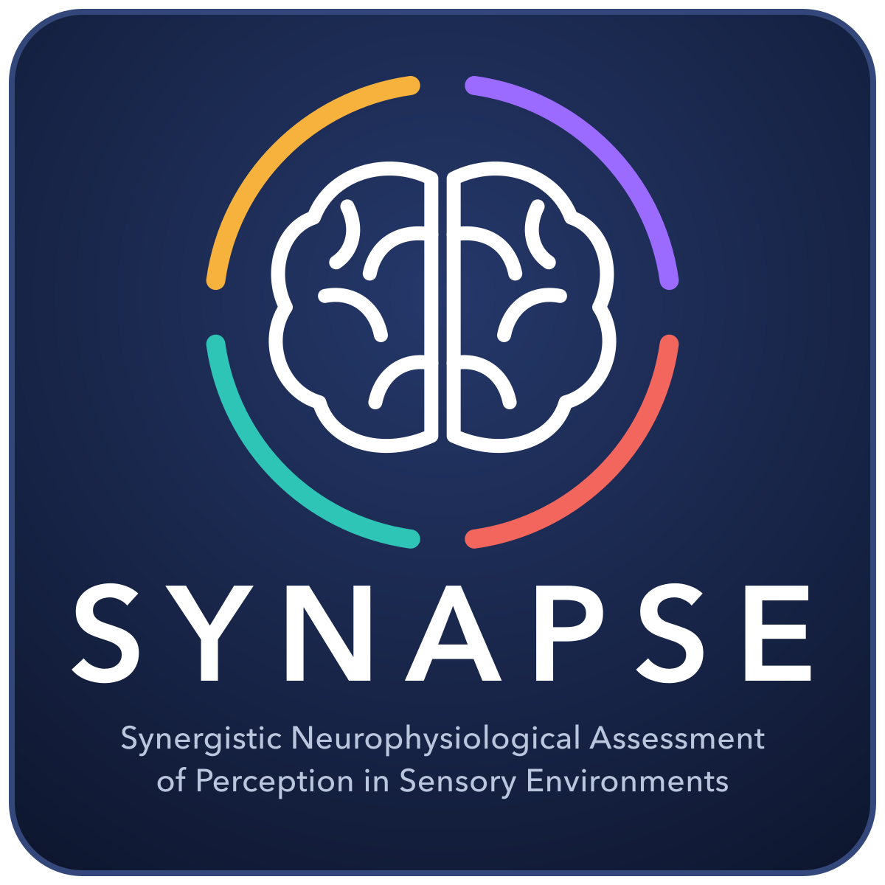

<h1 align="center">SYNAPSE study</h1>

  
  
  
  

## About

Occupants experience light, sound, heat and air at the same time, yet their combined effects on people are rarely
studied together. SYNAPSE is a laboratory study of how the indoor environment relates to the cognitive performance,
physiology and perception of people at work.

- **Participants and setting:** ten adults, two sessions each (20 sessions), in a simulated office at the Technical
  University of Denmark, June 2025.
- **Conditions:** warm (2014 K) or cool (6250 K) LED lighting per session; two headphone soundscapes (cafeteria babble,
  road traffic) per session; the thermal and air-quality conditions were monitored.
- **Measures:** computerised cognitive tasks (n-back, Stroop, visual counting or shape comparison, flanker),
  four-channel EEG, wrist photoplethysmography, acceleration and skin temperature, facial thermography, room conditions,
  and questionnaires on alertness, affect, task experience and the perceived indoor environment.

This repository is the home of the study: it brings together its code, publications and materials.

## Resources

| Resource | Description | Link |
|---|---|---|
| Dataset | Multimodal dataset in BIDS format, CC BY 4.0 | https://doi.org/10.5281/zenodo.23458777 |
| Protocol | Step-by-step experimental procedure | https://doi.org/10.17504/protocols.io.m7vznm25rvx1/v1 |
| Experiment platform | Browser software for the tasks and questionnaires | [synapse.ptomar.com](https://synapse.ptomar.com) · [source code](https://github.com/tomarp/synapse-platform) · https://doi.org/10.5281/zenodo.23768060 |

## Publications

| Publication | Status | Code |
|---|---|---|
| Tomar, P., Dave, T., Wargocki, P. & Pisello, A. L. *Multimodal dataset of cognitive performance, physiology and indoor environment under lighting and soundscapes.* Data Descriptor. | submitted to *Scientific Data* | [`data_descriptor/`](data_descriptor/) |
| Effects of lighting colour temperature and urban soundscapes on cognitive performance, perceived indoor environment and physiology | in preparation; [analysis plan](results_paper/ANALYSIS_PLAN.md) registered | [`results_paper/`](results_paper/) |

## Repository

| Folder | Content |
|---|---|
| [`curation/`](curation/) | Curation pipeline from the raw recordings to the published BIDS dataset, integrity tests and the register of curation decisions |
| [`data_descriptor/`](data_descriptor/) | Technical validation: figures, tables and numbers of the Data Descriptor, reproducible from the published dataset |
| [`results_paper/`](results_paper/) | Results paper (in preparation): registered analysis plan and the analysis code, frozen before unblinding |
| [`assets/`](assets/) | Study logo |

Each folder has its own README with setup and usage.

## How to cite

Please cite the dataset and, once published, the Data Descriptor:

> Tomar, P., Dave, T., Wargocki, P. & Pisello, A. L. (2026). *SYNAPSE: cognitive performance, EEG, wrist physiology,
> facial thermography and indoor environment under warm and cool LED lighting and urban soundscapes* (Version 1.0.0)
> [Data set]. Zenodo. https://doi.org/10.5281/zenodo.23458777

Machine-readable citation metadata: [`CITATION.cff`](CITATION.cff).

## Team

Puneet Tomar1,2 ([ORCID](https://orcid.org/0000-0002-5168-5471)) · Tanmay Dave2
([ORCID](https://orcid.org/0009-0004-1255-9140)) · Pawel Wargocki2
([ORCID](https://orcid.org/0000-0003-3865-3560)) · Anna Laura Pisello1
([ORCID](https://orcid.org/0000-0002-4527-6444))

1 Environmental Applied Physics Lab at CIRIAF, Department of Engineering, University of Perugia, Italy ·
2 Department of Environmental and Resource Engineering, Technical University of Denmark, Denmark

Questions and issues: please open a [GitHub issue](https://github.com/tomarp/synapse-study/issues).

## Licence

Code: MIT ([`LICENSE`](LICENSE)). Study logo: CC BY 4.0. The dataset is licensed separately under CC BY 4.0.

## Funding

This work was funded by the European Union's Horizon Europe research and innovation programme under the Marie
Skłodowska-Curie Doctoral Network MuSIC (grant agreement No. 101073357).
